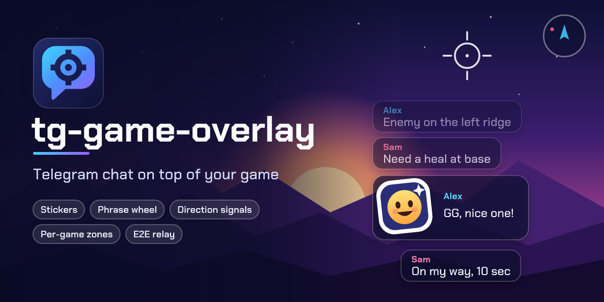

<p align="center">
  
</p>

<p align="center">
  <a href="https://github.com/wyrtensi/tg-game-overlay/releases/latest"></a>
  <a href="https://github.com/wyrtensi/tg-game-overlay/releases?q=server"></a>
  <a href="https://github.com/wyrtensi/tg-game-overlay/actions/workflows/ci.yml"></a>
  
  
  
  <a href="LICENSE"></a>
</p>

**tg-game-overlay** puts a chat on top of games that have none. Messages fade in
over the game, you answer without alt-tabbing, and your friends see it in their
own overlay or in a regular Telegram client.

The chat travels one of two ways:

- **Telegram** (the main mode): sign in with your own account and mirror any
  chat, group or forum topic.
- **Your own relay server**: a tiny Docker service you host yourself. Messages
  are end-to-end encrypted on each PC; the server only forwards ciphertext and
  serves a shared sticker catalog.

> The interface is in Russian. Windows 10 and 11 only.

## Features

- Transparent, click-through chat drawn inside each game's window, with zones
  you place per game; it follows resolution changes and hides with the game.
- A hotkey to type without leaving the game; Esc or Enter hands focus back.
- Stickers, animated ones too (TGS, WebP, WebM), and pasted images.
- **Phrase wheel**: hold a hotkey, flick the mouse, release to send a callout.
- **Direction signals**: arrow keys show a big arrow to everyone in the chat.
- Tray app that never steals focus; per-game show / hidden / blocked modes.
- Looks you can tune: font scale, colours, bubbles, shadows, timings.

## Install

1. Download `tg-game-overlay_<version>_x64-setup.exe` from the
   [latest release](https://github.com/wyrtensi/tg-game-overlay/releases/latest)
   and run it. WebView2 ships with Windows 11; the installer fetches it on
   Windows 10 when it is missing.
2. The app starts in the tray. Left click the tray icon for the settings.
3. Follow the **Готовность к игре** card at the top: it always points at the
   next step.

### Telegram mode

Release builds contain **no Telegram API keys**. Every user brings their own,
which takes two minutes:

1. Open [my.telegram.org](https://my.telegram.org), sign in and choose
   **API development tools**.
2. Create an application (any name; platform *Desktop*) and copy `api_id` and
   `api_hash`.
3. In the app, open **Telegram → Свои ключи Telegram**, paste both values and
   save. They are stored for your Windows user only (DPAPI) and never leave
   your PC.
4. Sign in with your phone number and the code Telegram sends you, then pick
   the chat to mirror.

Your Telegram session and keys are encrypted with Windows DPAPI under your
account. The app talks to Telegram directly; there is no server of ours in
between.

### Relay mode

1. Someone in your group runs the relay server (see below) and shares its
   address and **access key**.
2. In **Способ связи** choose **Свой сервер**, enter the address
   (for example `203.0.113.10:8790`), the access key, a room name, a room
   password and the name others will see.
3. Everyone who enters the same room name and password lands in the same chat.
   A wrong password simply opens a different, empty room.

## Relay server

A Node.js service of about a thousand lines with a single dependency (`ws`). It
idles at roughly 20 MiB of RAM and runs comfortably next to other services on
a 1 GB VPS.

```sh
mkdir tg-overlay-relay && cd tg-overlay-relay
curl -LO https://raw.githubusercontent.com/wyrtensi/tg-game-overlay/main/server/docker-compose.yml
curl -LO https://raw.githubusercontent.com/wyrtensi/tg-game-overlay/main/server/.env.example
cp .env.example .env
openssl rand -base64 32   # paste as ACCESS_KEY, share it with your friends
openssl rand -base64 32   # paste as ADMIN_KEY, keep it for yourself
docker compose up -d
curl http://localhost:8790/health   # ok
```

The same files, plus the sticker upload script, are attached to every
[`server-v*` release](https://github.com/wyrtensi/tg-game-overlay/releases?q=server)
as `tg-game-overlay-server-<version>.tar.gz`. The image is published as
`ghcr.io/wyrtensi/tg-game-overlay-server`. The
default port is 8790; ports 80 and 443 are not needed. Stickers are uploaded
with `server/scripts/upload-stickers.mjs` and the admin key, and every client
caches them locally by content hash. The full operator guide is in
[server/README.md](server/README.md).

### How the encryption works

- Each client derives a key from the room name and password
  (PBKDF2-SHA256, 600 000 iterations, then HKDF) and encrypts every message
  with AES-256-GCM, a fresh random nonce and the room id as associated data.
  Messages are padded to 256-byte blocks.
- The server sees only a room id (a hash), ciphertext sizes and timing. It
  cannot read text, names, stickers or images in messages.
- The access key is never sent: clients answer a random challenge with an HMAC.
- Limits worth knowing: without a TLS proxy in front, metadata is visible on
  the network; everyone in a room shares one key, so rooms are meant for
  friends; the sticker catalog is protected by the access key, not encrypted.

The wire protocol is documented in [server/PROTOCOL.md](server/PROTOCOL.md).

## Build from source

Requirements: Windows, Rust (MSVC toolchain) with Visual Studio Build Tools
(C++ workload), Node.js 20+.

```sh
npm install
npm run tauri dev       # development
npm run tauri build     # installer in src-tauri/target/release/bundle
```

Optional: to embed your own Telegram keys into a private build, put
`{"apiId": 123, "apiHash": "..."}` into `src-tauri/credentials.json` (ignored by
git) or set `TG_API_ID` / `TG_API_HASH`. Public releases are built with
`TGO_NO_EMBEDDED_KEYS=1`, so no keys can slip into them.

```sh
npm test                          # frontend and relay client (vitest)
cd src-tauri && cargo test        # backend (Rust)
cd server && npm test             # relay server (node:test)
```

## How it works

- `src-tauri/` is the Rust backend: the overlay state machine, foreground
  window tracking, hotkeys, tray, config and DPAPI-protected secrets.
- `src/overlay/` is the transparent page drawn over the game.
- `src/main/` is the settings window.
- `src/telegram/` is a hidden worker that owns the MTProto client (GramJS).
- `src/relay/` is a hidden worker for the relay transport: WebCrypto, the
  WebSocket client and the sticker cache.
- `server/` is the relay server.

Pages never talk to each other directly; Rust is the bus. See
[CONTRACT.md](CONTRACT.md) for the events and commands.

## Known limits

- Exclusive fullscreen (older DX9 to DX11 games) hides topmost windows; run
  such games in borderless windowed mode.
- Games are matched by executable name; protected processes may not report one.

## Кратко по-русски

Оверлей чата для игр без встроенного чата. Работает через ваш Telegram
(свои `api_id`/`api_hash` берутся на my.telegram.org) или через собственный
лёгкий сервер со сквозным шифрованием в Docker. Установщик лежит в
[релизах](https://github.com/wyrtensi/tg-game-overlay/releases/latest),
сервер публикуется отдельным релизом и образом `ghcr.io/wyrtensi/tg-game-overlay-server`.

## License

[MIT](LICENSE)
